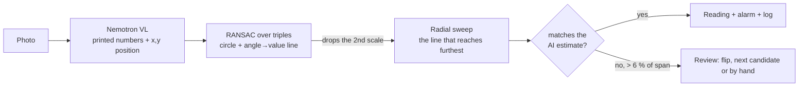

# Gauge Reader

**Photo of a needle pressure gauge or dial thermometer, and the reading comes out as a number with alarm limits and a log. The AI reads the scale once; geometry and classic vision do the rest.**

[Español](README.md) · **English**

> The interface is in Spanish.

## The problem

Mines and plants still have hundreds of analog gauges that are read on rounds and written down by hand. Data arrives late, with transcription errors and no trend.

## How it works

Asking a vision model "what does the needle read?" often fails: it mixes scales and misses by several divisions. So the AI only does what it does well, **reading and locating the printed numbers**, and the rest is verifiable geometry.

1. **AI, once per gauge.** Nemotron VL returns each scale number with its position (0-1000) plus its own reading estimate.
2. **Geometry.** RANSAC over number triples fits the dial circle and an angle-to-value line. Numbers that don't fit (a second scale, a logo) are discarded.
3. **Classic vision.** A 720-direction radial sweep finds the line that runs continuously from the hub and reaches furthest toward the scale. That separates the tip from the counterweight, which is also dark but stops short. Lateral tolerance is in pixels, so a slightly-off center still works. The AI estimate does not choose the needle; it is only a check.
4. **Cross-check.** If geometry and AI disagree by more than 6 % of the span, the page flags it. The "¿La lectura está mal?" panel corrects the reading and shows the automatic reading's error.
5. **Fixed camera.** With a still camera the AI calibrates once and needle tracking runs in the browser many times per second, with no further API calls.

## Limits

- Round, single-needle gauges. No digital displays or multi-needle meters.
- Strong glare or very oblique photos hurt number location; the cross-check flags it.
- A reading aid for rounds, not a calibrated instrument.

## Files

| File | What it is |
|---|---|
| `index.html` | The whole tool: RANSAC fit, radial sweep, fixed-camera mode, alarms and log. |
| `s/` | Sample photos with their cached scale reading. |
| `docs/` | Demo GIF and diagrams. |

Locally: `python3 -m http.server 8770`. Live scale reading uses [nv-gateway](https://github.com/JSNN15/nv-gateway).

## Credits

Sample photos (their authors' licenses): *Pressure gauge* (zimpenfish), *Back-Entry-Dial-Thermometer* (Public Domain Photos), *residual pressure gauge* (yawning hunter), *Under Pressure* (ThenAndAgain), *Pressure* (BinaryApe), *Increasing Pressure* and *That's all she's got captain!* (flattop341), *Gauge on a U-Boat* (quinet), CC BY 2.0 via Openverse.

In 6 of the 8 samples the geometric reading matches the AI's independent estimate. In the other two (the tire gauge and the submarine gauge) the needle rests at 0 and the AI estimated 65 and 0.55: it took the counterweight for the tip. Geometry reads them correctly and the page flags the disagreement.

The first version of the sweep made the same counterweight mistake on those two, because it picked the darkest line near the hub. It now measures each line's reach, and if it still gets it wrong, the "¿La lectura está mal?" panel lets you take the opposite end, try another candidate or set it by hand, and shows the automatic reading's error.

---

Personal project by **Julián Neira Nova**, electrical engineer with 10 years in mining operations · Servicio y Soluciones Tecnológicas DelaCruz SpA. Nothing here comes from clients or employers.
[Portfolio](https://jsnn15.github.io/) · [LinkedIn](https://www.linkedin.com/in/julian-neira-nova/) · [All tools](https://github.com/JSNN15)
