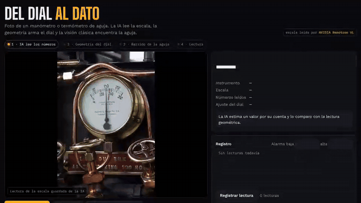
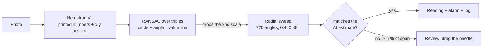

# Gauge Reader

**Photo of a needle pressure gauge or dial thermometer, and the reading comes out as a number with alarm limits and a log. The AI reads the scale once; geometry and classic vision do the rest.**

[Español](README.md) · **English**

> The interface is in Spanish.

## The problem

Mines and plants still have hundreds of analog gauges that are read on rounds and written down by hand. Data arrives late, with transcription errors and no trend.

## How it works

Asking a vision model "what does the needle read?" often fails: it mixes scales and misses by several divisions. So the AI only does what it does well, **reading and locating the printed numbers**, and the rest is verifiable geometry.

1. **AI, once per gauge.** Nemotron VL returns each scale number with its position (0-1000) plus its own reading estimate.
2. **Geometry.** RANSAC over number triples fits the dial circle and an angle-to-value line. Numbers that don't fit (a second scale, a logo) are discarded.
3. **Classic vision.** A radial sweep finds the highest-contrast direction from the hub; among in-range candidates, the AI estimate picks the tip over the tail.
4. **Cross-check.** If geometry and AI disagree by more than 6 % of the span, the page asks for review and lets you drag the tip.
5. **Fixed camera.** With a still camera the AI calibrates once and needle tracking runs in the browser many times per second, with no further API calls.

## Limits

- Round, single-needle gauges. No digital displays or multi-needle meters.
- Strong glare or very oblique photos hurt number location; the cross-check flags it.
- A reading aid for rounds, not a calibrated instrument.

## Files

| File | What it is |
|---|---|
| `index.html` | The whole tool: RANSAC fit, radial sweep, fixed-camera mode, alarms and log. |
| `s/` | Sample photos with their cached scale reading. |
| `docs/` | Demo GIF and diagrams. |

Locally: `python3 -m http.server 8770`. Live scale reading uses [nv-gateway](https://github.com/JSNN15/nv-gateway).

## Credits

Sample photos (their authors' licenses): *Pressure gauge* (zimpenfish), *Back-Entry-Dial-Thermometer* (Public Domain Photos), *residual pressure gauge* (yawning hunter), *Under Pressure* (ThenAndAgain), *Pressure* (BinaryApe), *Increasing Pressure* and *That's all she's got captain!* (flattop341), *Gauge on a U-Boat* (quinet), CC BY 2.0 via Openverse.

In 7 of the 8 samples the geometric reading matches the AI's independent estimate. On the submarine gauge (kg/cm²) they disagree: geometry reads 0.63, which is correct, and the AI estimated 0.55. That is why the page flags "Revisar" (check) instead of picking one.

---

Personal project by **Julián Neira Nova**, electrical engineer with 10 years in mining operations · Servicio y Soluciones Tecnológicas DelaCruz SpA. Nothing here comes from clients or employers.
[Portfolio](https://jsnn15.github.io/) · [LinkedIn](https://www.linkedin.com/in/julian-neira-nova/) · [All tools](https://github.com/JSNN15)
