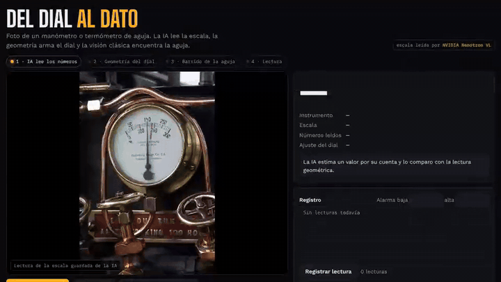
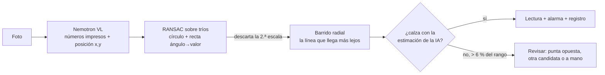

# Lector de instrumentos

**Foto de un manómetro o termómetro de aguja y la lectura sale en número, con alarma y registro. La IA lee la escala una vez; la geometría y la visión clásica hacen el resto.**

**Español** · [English](README.en.md)

## El problema

En faena todavía hay cientos de instrumentos de aguja que se leen en una ronda y se anotan a mano. El dato llega tarde, con errores de transcripción y sin tendencia.

## Cómo funciona

Preguntarle a un modelo de visión "¿cuánto marca la aguja?" falla seguido: confunde escalas y se equivoca por varias divisiones. Por eso la IA hace solo lo que hace bien, **leer y ubicar los números impresos**, y el resto es geometría que se puede verificar.

1. **IA, una vez por instrumento.** Nemotron VL entrega cada número de la escala con su posición (0-1000) y además una estimación propia de la lectura.
2. **Geometría.** Con tríos de números, RANSAC ajusta la circunferencia del dial y una recta ángulo-valor. Los números que no calzan (una segunda escala, un logo) quedan fuera.
3. **Visión clásica.** Un barrido radial de 720 direcciones busca la línea que sale continua del eje y llega más lejos hacia la escala. Así distingue la punta del contrapeso, que también es oscuro pero se corta antes. La tolerancia lateral va en píxeles para soportar un centro estimado con algo de error. La estimación de la IA no elige la aguja: solo sirve de control.
4. **Control cruzado.** Si la lectura geométrica y la de la IA difieren en más de 6 % del rango, la página avisa. El panel «¿La lectura está mal?» corrige y muestra el error de la lectura automática.
5. **Cámara fija.** Con la cámara quieta, la IA calibra una sola vez y el seguimiento de la aguja corre en el navegador muchas veces por segundo, sin más llamadas.

## Límites

- Instrumentos circulares de una aguja. No lee displays digitales ni medidores de varias agujas.
- Reflejos fuertes o fotos muy oblicuas degradan la ubicación de los números; el control cruzado lo avisa.
- Es una lectura de apoyo para rondas, no un instrumento calibrado.

## Archivos

| Archivo | Qué es |
|---|---|
| `index.html` | La máquina completa: ajuste RANSAC, barrido radial, modo cámara fija, alarmas y registro. |
| `s/` | Fotos de ejemplo con la lectura de escala guardada. |
| `docs/` | GIF de la demo y diagramas. |

En local: `python3 -m http.server 8770`. La lectura de escala en vivo usa [nv-gateway](https://github.com/JSNN15/nv-gateway).

## Créditos

Fotos de ejemplo (licencias de sus autores): *Pressure gauge* (zimpenfish), *Back-Entry-Dial-Thermometer* (Public Domain Photos), *residual pressure gauge* (yawning hunter), *Under Pressure* (ThenAndAgain), *Pressure* (BinaryApe), *Increasing Pressure* y *That's all she's got captain!* (flattop341), *Gauge on a U-Boat* (quinet), CC BY 2.0 vía Openverse.

De los 8 ejemplos, en 6 la lectura geométrica coincide con la estimación independiente de la IA. En los otros dos (el manómetro de neumáticos y el del submarino) la aguja está en 0 y la IA estimó 65 y 0,55: tomó el contrapeso por la punta. La geometría los lee bien y la página avisa que no coinciden.

La primera versión del barrido también confundía el contrapeso con la punta en esos dos casos, porque elegía la línea más oscura cerca del eje. Ahora mide el alcance de cada línea y, si aun así se equivoca, el panel «¿La lectura está mal?» permite usar la punta opuesta, probar otra candidata o ajustar a mano, y muestra el error de la lectura automática.

---

Proyecto personal de **Julián Neira Nova**, ingeniero eléctrico con 10 años en faena · Servicio y Soluciones Tecnológicas DelaCruz SpA. Nada de lo publicado proviene de clientes ni de empleadores.
[Portafolio](https://jsnn15.github.io/) · [LinkedIn](https://www.linkedin.com/in/julian-neira-nova/) · [Todas las máquinas](https://github.com/JSNN15)
